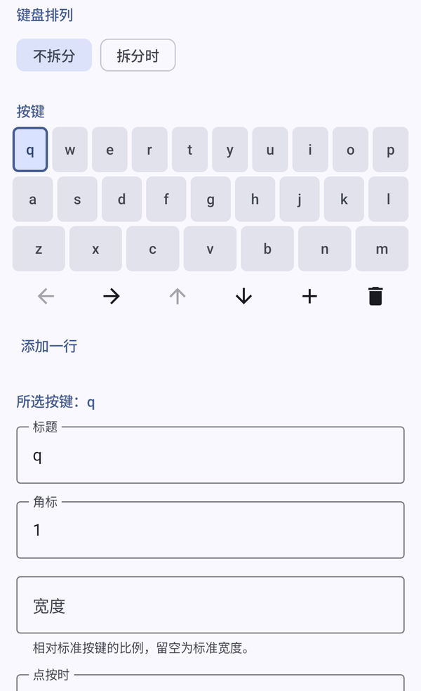
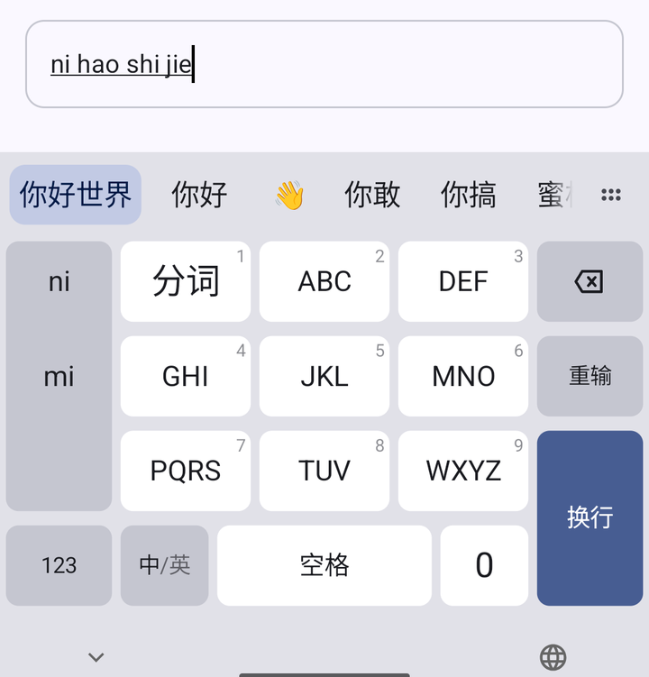
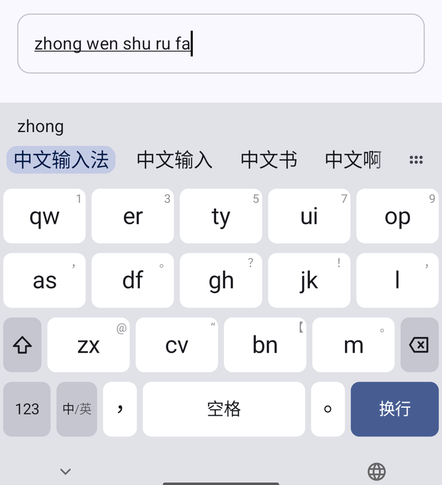
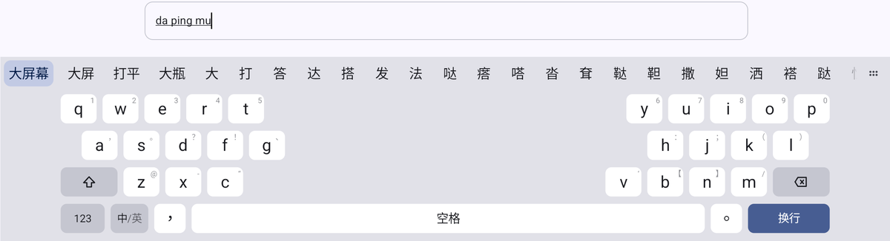
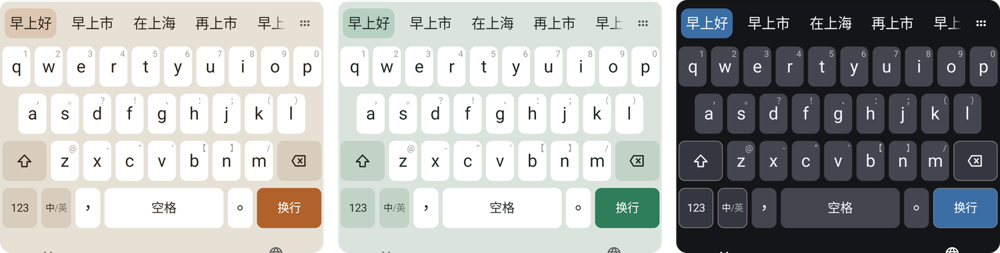

# Songyan for Android (松烟)

[](https://github.com/Suzukaa-a/songyan-android/actions/workflows/ci.yml)
[](https://github.com/Suzukaa-a/songyan-android/releases)
[](LICENSE)

[简体中文](README.zh-CN.md)

An Android keyboard built on the [RIME](https://rime.im) input method engine. Design every key and every page yourself. Use any RIME input scheme directly on 9, 14, or 18 keys. Keyboard layout and appearance files work interchangeably with [Songyan for iOS](https://github.com/Suzukaa-a/songyan-ios).

## Install

1. Download the APK from [Releases](https://github.com/Suzukaa-a/songyan-android/releases):
   `universal` works on every phone, `arm64-v8a` is smaller and fits almost all recent ones.
   Android 11 or later.
2. Open Songyan. The guide walks you through picking an input scheme and turning the keyboard on
   (Settings > System > Keyboard > On-screen keyboard; the path varies by phone).

## Highlights

### Design your own keyboard

<p align="center">
  
</p>

- Customize any key: its label, corner hint, width, tap action, long-press options, and swipe-input character.
- Add, delete, or move keys; the bottom row and the side columns of the 9-key layout can also be adjusted.
- Set where each row splits and how far apart the halves sit, independently for each keyboard layout.
- Create your own 123, symbol, and ABC pages in the page library, then pair them with each keyboard.
- Choose which input methods and keyboard layouts appear in the keyboard menu, which buttons sit on the toolbar, and the quick symbols for 9 keys.
- Show double pinyin final hints on letter keys, and write hints yourself or import them from a link.
- Export keyboard layouts and pages as files to share, or import files from others; they work on iOS too.

### Any input scheme on 9 keys

<p align="center">
  
  
</p>

Songyan automatically generates 9, 14, and 18-key layouts from the input scheme you are already using, without needing extra schemes. Whether you use rime-ice, wanxiang, or a custom imported scheme, simply switch the keyboard layout and keep typing—with the same dictionary and learned words.

### Large and foldable screens

<p align="center">
  
</p>

When the keyboard width exceeds your set threshold, it splits into two halves for comfortable two-thumb typing. You can adjust the split threshold width, middle spacing, key area alignment, and side margins. Key spacing and font size can also scale with the screen.

### Appearance

<p align="center">
  
</p>

Extract colors from your wallpaper, use built-in appearances, or create your own with the [appearance editor](https://suzukaa-a.github.io/songyan-themes/) and import the file directly. You can also customize the candidate bar style and reading display position. Appearance files work on both Android and iOS.

### Add features to the keyboard

- **Scripts:** Paste a JavaScript snippet to add custom features, such as polishing or translating text with your own AI model. Preview the result before confirming replacement or insertion.
- **Voice input:** Choose a voice script, press the microphone button to speak, and let the script handle transcription.
- **Extensions:** Install an app that supports Songyan to provide text tools, voice input, or dedicated panels.

### What you type stays on your device

The input method engine runs locally on your phone, and the keyboard itself does not connect to the internet. Scripts can only reach websites they declare, which are clearly listed for your confirmation before you add them.

## All features

- **Input schemes:** Any RIME input scheme, including Pinyin, Double Pinyin, Zhuyin, Cangjie, Quick, Cantonese, Japanese, and more. Add from the recommended list, or import from files, folders, or links. Nothing is downloaded until you confirm.
- **Keyboard layouts:** 26, 14, 18, and 9 keys, plus Zhuyin, Cangjie, Japanese Romaji, and Kana layouts. Layouts are editable, and you can make your own number and symbol pages.
- **Cursor:** Hold space and slide to move the cursor; slide during composing to move within the spelling.
- **Phrases, clipboard history, emoji, and symbol library:** Use them directly in the keyboard.
- **From RIME:** Simplified/Traditional conversion (including Taiwan and Hong Kong standards), fuzzy pinyin, typo correction, prediction, grammar models, Lua scripts, and `custom.yaml` configuration, toggled per input method in Settings; back up and merge learned words.
- **Scripts:** Paste or import JavaScript code to add custom features to your keyboard. Results can be previewed before replacing or inserting, with undo support.
- **Voice input:** Select a voice script, use the microphone button on the keyboard to record, and let the script handle transcription.
- **Extensions:** After installing a Songyan-supported standalone app, enable it in Settings > Extensions to provide text tools, voice input, or custom panels.
- Interface available in English, Simplified Chinese, Traditional Chinese, and Japanese.

## Privacy

What you type stays on your device. The keyboard itself does not go online; the settings app
connects only when you ask it to download or import something.

<details>
<summary>Full privacy policy</summary>

Songyan itself collects no personal data and sends nothing to its developers. The scripts you add
are the exception: when one runs, it sends the text it works on to the sites it declares or the
addresses you enter in its settings (plain http reaches only an address you entered on this device
or your local network). Those requests go straight from your phone, not through Songyan's servers.
Extensions are separate apps you install yourself, and the system shows you the permissions they
use.

- What you type stays on your device. The words it learns, your phrases, the clipboard history
  (off until you turn it on), settings, layouts and appearances are stored in the app's private
  storage.
- The keyboard itself does not go online. The settings app connects to the internet only when you
  ask it to: downloading an input scheme, dictionary or model, or importing from a link you enter.
  Those requests go to the site that hosts the file (for example GitHub), which sees your IP
  address as with any download; nothing about you or your typing is sent.
- While a script runs, its requests go only to the sites that
  script declares or the addresses you entered in its settings. Nothing else about you or your typing is sent.
- Voice input records only while a take is running (you start and stop it with the microphone
  button), and only if you have chosen a voice script. The temporary recording is handed to that
  script and deleted after the run.
- Password fields and fields that ask for no personalized learning are never learned from, and
  the clipboard is not recorded in them.
- Android backup, when you have it on, includes the learned words, phrases, settings, layouts,
  appearances and your Rime configuration files, never the clipboard history. Backup is run by
  the system and your Google account, not by Songyan.
- Permissions: internet and network state for the downloads above and for the sites your scripts
  reach; the microphone for voice input; a foreground service and notification while an input
  scheme is being prepared; vibration for key feedback.
- Uninstalling the app deletes all of its data. Questions: open an issue in this repository.

</details>

## Build from source

```bash
./gradlew assembleDebug                  # APK in app/build/outputs/apk/debug/
scripts/install-debug.sh --enable-ime    # install on a connected device and turn the keyboard on
```

Toolchain, checks and project rules are in [CONTRIBUTING.md](CONTRIBUTING.md); the module map is in
[docs/ARCHITECTURE.md](docs/ARCHITECTURE.md). Report security problems as described in
[SECURITY.md](SECURITY.md).

## License

[GPL-3.0-only](LICENSE). Third-party components and their licenses are listed in the app
(Settings > About > Open Source Licenses).
