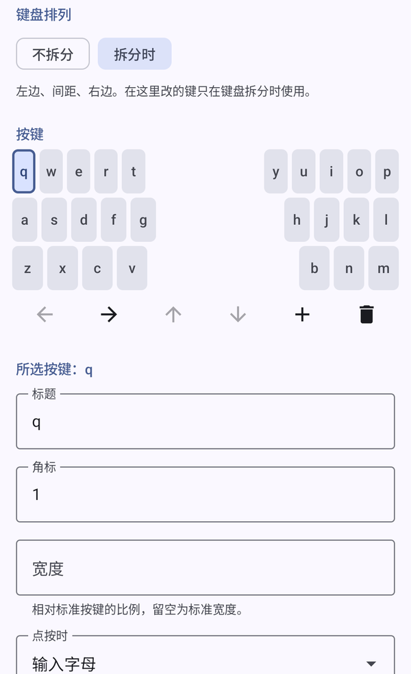
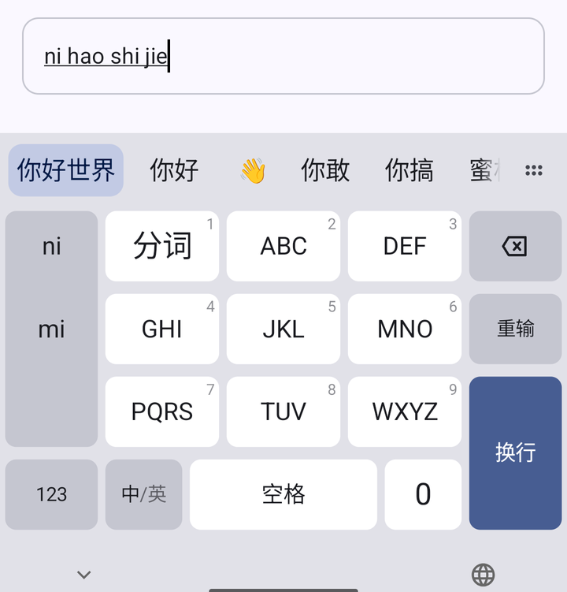
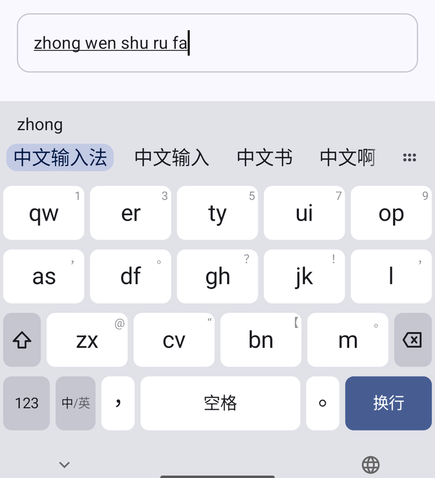
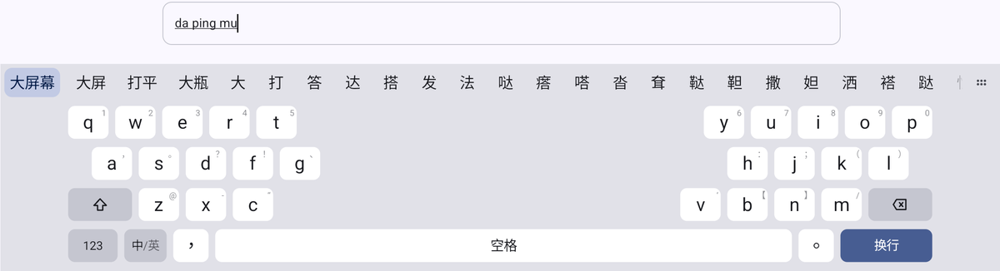
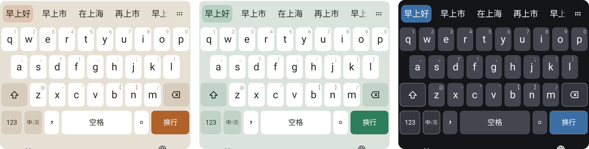

# 松烟 Android 版

[](https://github.com/Suzukaa-a/songyan-android/actions/workflows/ci.yml)
[](https://github.com/Suzukaa-a/songyan-android/releases)
[](LICENSE)

[English](README.md)

基于 [RIME 中州韵](https://rime.im) 引擎的 Android 输入法。键盘的每个键、每个页面都能自己设计。任何 RIME 输入方案都能直接使用九键、14 键与 18 键。键盘布局与键盘外观文件与 [松烟 iOS 版](https://github.com/Suzukaa-a/songyan-ios) 通用。

## 安装

1. 从 [Releases](https://github.com/Suzukaa-a/songyan-android/releases) 下载 APK：`universal` 适用于所有手机，`arm64-v8a` 更小，适用于几乎所有近几年的手机。需要 Android 11 或更高版本。
2. 打开松烟，按引导选一个输入方案并启用键盘（设置 > 系统 > 键盘 > 屏幕键盘，路径因机型而异）。

## 特色

### 自己设计键盘

<p align="center">
  
</p>

- 每个键都能改：标题、角标、宽度、点按动作、长按选项与滑动输入的字符。
- 键可以添加、删除或移动位置；底栏和九键的左右栏也能调整。
- 拆分时每一行从哪里分开、两边相隔多远，都可以按键盘布局分别设置。
- 123、符号和 ABC 页面可以自己做，放进页面库，再给每个键盘搭配。
- 键盘菜单中显示哪些输入方式和键盘布局、工具栏放置哪些按钮、九键的快捷符号，都由你决定。
- 双拼方案可以在字母键上显示韵母提示，提示可以自己编写，也能从链接导入。
- 布局和页面可以导出成文件分享，也能导入别人做的；iOS 版也能用。

### 任何输入方案都能用九键

<p align="center">
  
  
</p>

松烟按你正在用的输入方案自动生成九键、14 键和 18 键，不用另装方案。雾凇拼音、万象拼音或你自己导入的方案，换个布局就能接着打，词库和学到的词还是同一份。

### 大屏和折叠屏

<p align="center">
  
</p>

键盘宽度超过设定值时拆成左右两半，两手各打一边。拆分的判定宽度、中间间距、键区位置和两侧留白都能调，按键间距和字号也能随屏幕放大。

### 外观

<p align="center">
  
</p>

可以跟随壁纸取色、用内置外观，也可以用[网页外观编辑器](https://suzukaa-a.github.io/songyan-themes/)自己做，再导入文件。候选栏样式和读音的位置也能选。外观文件 Android 和 iOS 通用。

### 给键盘加功能

- **脚本**：粘贴一段 JS，就能给键盘加一个功能，比如用你自己的大模型润色或翻译。结果先预览，再替换或插入。
- **语音输入**：选择一个语音脚本，按麦克风按钮说话，转写由该脚本完成。
- **扩展**：安装支持松烟的独立 App 后，它可以为键盘提供文本工具、语音输入或自定义面板。

### 打字的内容不离开设备

引擎在手机上运行，键盘本身不联网。脚本只能连它声明过的网站，添加前会列给你看。

## 全部功能

- **输入方案**：任何 RIME 输入方案，拼音、双拼、注音、仓颉、速成、粤拼、日语等；可从推荐列表添加，也可从文件、文件夹或链接导入。你确认后才会下载。
- **键盘布局**：提供 26 键、14 键、18 键、9 键，以及注音、仓颉、日语罗马字和假名键盘。布局可以编辑，数字和符号页也能自己做。
- **光标**：按住空格滑动移动光标；输入过程中滑动可在拼写内移动。
- **常用语、剪贴板记录、表情与符号库**：直接在键盘中使用。
- **RIME 提供的功能**：简繁转换（也有台湾、香港用字）、模糊音、错键纠正、联想、语法模型、Lua 脚本与 `custom.yaml` 配置，在设置中按输入方式分别开关；学到的词可以备份和合并。
- **脚本**：粘贴或导入一段 JS 代码，为键盘添加自定义功能。结果先预览再替换或插入，可以撤销。
- **语音输入**：选择一个语音脚本，使用键盘上的麦克风按钮录音，由该脚本完成文字转写。
- **扩展**：安装支持松烟的独立 App 后，可在「设置 > 扩展」中开启，为键盘提供文本工具、语音输入或自定义面板。
- 界面提供英语、简体中文、繁体中文和日语。

## 隐私

你输入的内容只留在你的设备上。键盘本身不联网，只有你在设置里主动下载或导入时才联网。

<details>
<summary>隐私政策全文</summary>

松烟自身不收集任何个人数据，也不向开发者发送数据。你添加的脚本是例外：运行时它会把要处理的文字发到它声明的网站，或你在它的设置里填的地址（明文 http 只能连你填的本机或局域网地址）。这些请求直接从你的手机发出，不经过松烟的服务器。扩展是你另外安装的 App，权限以系统显示为准。

- 你输入的内容只留在你的设备上。学到的词、常用语、剪贴板记录（默认关闭，你开启后才记录）、设置、布局和外观都存在应用的私有存储里。
- 键盘本身不联网。只有你在设置里主动操作时，设置界面才会联网：下载输入方案、词库或模型，或者从你填写的链接导入。这些请求发往存放文件的网站（例如 GitHub），对方和任何下载一样会看到你的 IP 地址；不会发送任何关于你或你输入内容的信息。
- 运行脚本时，它的请求只发往该脚本声明的网站或你在它的设置里填的地址；不会发送其他关于你或你输入内容的信息。
- 语音输入只在录音进行时使用麦克风（你用麦克风按钮开始和结束），并且只在你选了语音脚本后可用。临时录音交给这个脚本，运行结束后删除。
- 密码框和要求不做个性化学习的输入框不会学习，也不记录剪贴板。
- 开启 Android 备份时，备份包括学到的词、常用语、设置、布局、外观和你的 Rime 配置文件，不包括剪贴板记录。备份由系统和你的 Google 账号完成，不经过松烟。
- 权限：联网与网络状态用于上面的下载和脚本要连的网站；语音输入使用麦克风；准备输入方案时使用前台服务和通知；按键反馈使用振动。
- 卸载应用会删除它的全部数据。有问题请在本仓库提 issue。

</details>

## 从源码构建

```bash
./gradlew assembleDebug                  # APK 位于 app/build/outputs/apk/debug/
scripts/install-debug.sh --enable-ime    # 安装到已连接的设备并启用键盘
```

工具链、检查命令和项目规则见 [CONTRIBUTING.md](CONTRIBUTING.md)，模块结构见 [docs/ARCHITECTURE.md](docs/ARCHITECTURE.md)。安全问题请按 [SECURITY.md](SECURITY.md) 报告。

## 许可

[GPL-3.0-only](LICENSE)。第三方组件及其许可见应用内「设置 > 关于 > 第三方许可」。
